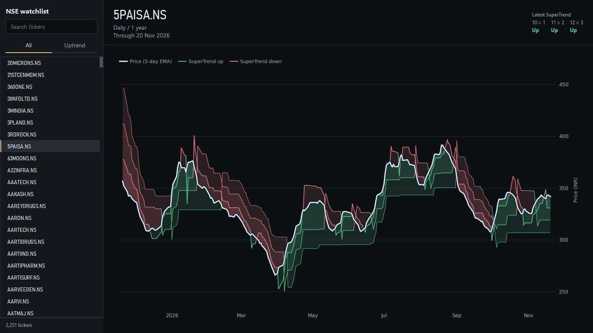
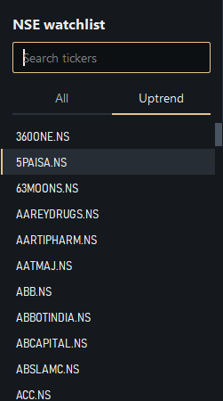

#  SuperTrend Charting Tool

A desktop app for charting NSE stocks and screening for agreement across three SuperTrend indicators.



## Find stocks and check the trend

| Search the NSE watchlist | Screen for uptrends |
| --- | --- |
|  |  |
| Type part of a ticker and press Enter to open the first match. | A ticker qualifies when the latest plotted segments of all three SuperTrend lines are green. Matches appear as the scan runs. |

Each chart shows one year of daily history, a 5-day price EMA, and the SuperTrend settings 10 × 1, 11 × 2, and 12 × 3. The chart header shows each indicator’s latest direction.

## Run locally

With Python 3.13 and `uv` installed, run these commands from the repository root.

```sh
uv sync --locked
uv run --locked python Code/main.py
```

Price history comes from Yahoo Finance and is cached locally. When the app displays older cached prices, it marks the chart with the date of the last session.
